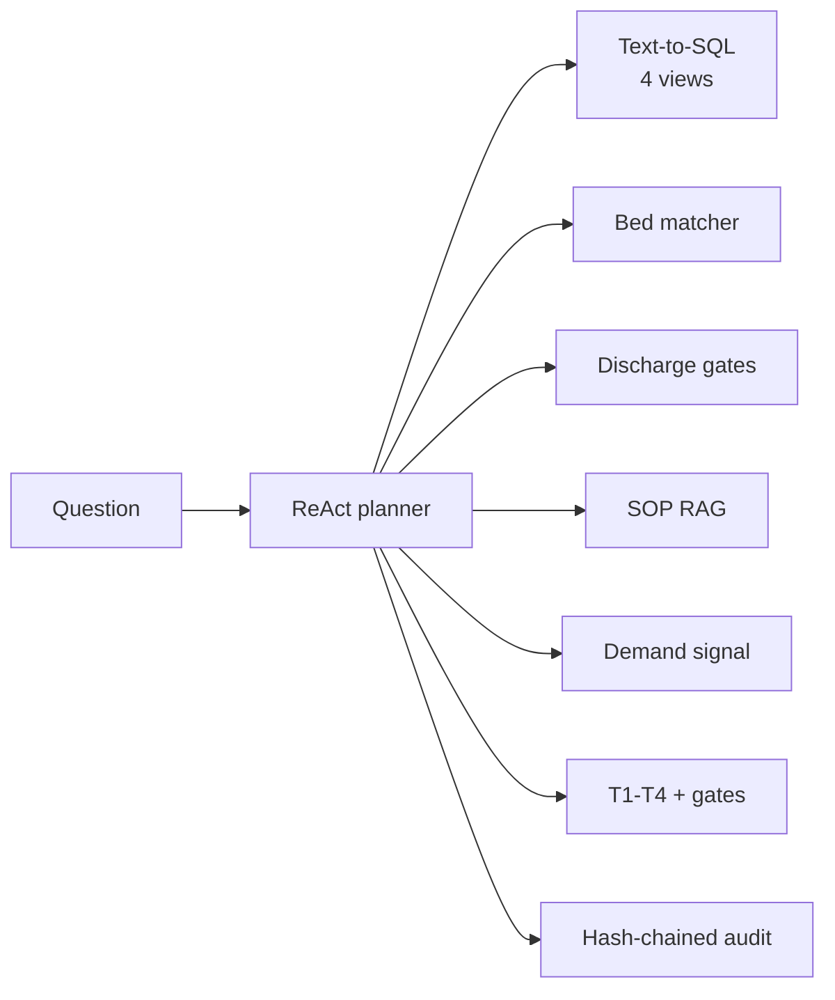

# Hospital Patient-Flow Operations Agents

> **Recruiter summary.** Hospitals don't run out of beds -- they run out of the
> *right bed at the right time*. This repo is an operations copilot for patient
> flow at a fictional hospital: it answers bed-occupancy, ED boarding,
> discharge, and staffing questions over governed read-only views, matches ED
> boarders to ward beds with a transparent acuity-weighted score, and gates
> discharge overrides behind human confirmation. 85 tests, all green; every
> figure below comes from a real run of this repo.

## Purpose and who it is for

For engineering leaders evaluating agentic AI for hospital operations, and for
engineers learning the Forward-Deployed-Engineer pattern: legacy-style
operational data → governed text-to-SQL → SOP-grounded answers → human-gated
actions → audit trail. Operational scope only -- this repo never gives
clinical advice (see Boundary below).

## How it works

1. **Ask** a plain-English operations question ("Which wards are over 90%
   occupied, and who is boarding in the ED?").
2. The planner **detects intents** (five governed intents, fan-out for
   multi-intent questions) and runs each against **four read-only SQLite
   views** through a SELECT-only gateway (denials cite rule IDs
   SEC-SELECT-01, SEC-WRITE-02, SEC-VIEW-03; a SQLite authorizer backs the view allowlist).
3. In parallel it queries the **SOP RAG** (TF-IDF over four hospital SOPs,
   every hit cited as `file §section`) and the **regional demand signal**
   (seeded fake backend; the live stub reports an explicit gap instead of
   hallucinating).
4. For boarding questions the **acuity-weighted bed matcher** scores free
   beds (`0.5·acuity_fit + 0.3·capability + 0.2·headroom`) and shows its
   breakdown. For discharge questions the **checklist gate** names exactly
   which items block each stay.
5. The planner assigns a **T1–T4 escalation tier** and mints **confirmation
   gate tokens** for high-impact actions (bed reassignments affecting >5
   patients; every discharge override). Nothing executes while a token is
   pending.
6. Every step lands in a **hash-chained audit log**; user feedback
   (thumbs/corrections) is **PII-scrubbed before storage** and appended to the
   same chain.

Clinical questions ("what medication for chest pain?") are refused outright
before any tool runs.

## Architecture



Full diagrams: [knowledge/architecture.md](knowledge/architecture.md).
Domain notes: [knowledge/domain-notes.md](knowledge/domain-notes.md).

## Real code, real output

Acuity-weighted bed matching (from an actual run, seed 42; the full output is
re-checked by CI in the review section below):

```
ED-0021 -> W-ICU-13 ICU 0.85 {'acuity_fit': 0.5, 'capability': 0.3, 'load': 0.05, 'total': 0.85}
ED-0007 -> W-ICU-14 ICU 0.8375 {'acuity_fit': 0.5, 'capability': 0.3, 'load': 0.0375, 'total': 0.8375}
```

Discharge gate on the seeded anchor stay:

```
ST-1040 ready: False | blocked by: ['discharge_summary_signed']
```

Planner answer (abridged, real run):

```
[boarder_backlog] 12 row(s) from governed views.
Longest-waiting acute boarder: ED-0021 (acuity 1, 15.6h waiting).
Bed match: ED-0021 (acuity 1) -> W-ICU-13 [ICU] score 0.85 ...
Per the hospital SOPs:
- sop-01-triage-and-boarding.md §Boarding definition: A patient is *boarding* ...
Escalation tier: T4.
```

PII scrubbing (real run):

```
in:  "nurse jane.doe@example.com called 415-555-0132, SSN 123-45-6789 on file is wrong"
out: "nurse [REDACTED-EMAIL] called [REDACTED-PHONE], SSN [REDACTED-SSN] on file is wrong"
```

## How to run

Offline first -- no API keys, no network, stdlib only:

```bash
python -m pytest tests/ -q          # 85 tests
python scripts/count_tests.py       # prints the real total
```

Optional demo UI:

```bash
pip install streamlit
streamlit run demo/app.py
```

## Module map

| Module | What it does |
|---|---|
| `hospops/hospital.py` | Synthetic telemetry seeder (SQLite, deterministic) |
| `hospops/views.py` | 4 read-only views + SELECT-only gateway (SEC-SELECT-01, SEC-WRITE-02, SEC-VIEW-03) + authorizer backstop (`authz.py`) |
| `hospops/text2sql.py` | 5 intents, fixed SQL templates, one simplified retry |
| `hospops/bedmatch.py` | **Differentiator:** acuity-weighted bed assignment with breakdown |
| `hospops/discharge.py` | **Differentiator:** checklist gates + confirmation-gated overrides |
| `hospops/escalation.py` | T1–T4 tiers + confirmation gates |
| `hospops/sop_rag.py` | TF-IDF SOP retrieval with citations, explicit not-found |
| `hospops/demand.py` | Fake/live regional demand signal with gap behavior |
| `hospops/audit.py` | SHA-256 hash-chained audit log |
| `hospops/feedback.py` | Feedback capture with PII scrubbing, wired into audit |
| `hospops/orchestrator.py` | ReAct planner + clinical-question refusal |
| `hospops/demo_helpers.py` | Stdlib demo logic (fully tested) |

## How this differs from the coldchain and retail repos

Same FDE spine (governed views, SOP RAG, tiers, audit), different domain
machinery -- this is the anti-copy-paste rule in action:

- **Bed matcher:** neither sibling has constrained assignment. Acuity
  eligibility is a hard rule (acuity 1 → ICU only), capability tags gate
  isolation patients, and every score ships its breakdown.
- **Discharge checklist gates:** a five-item readiness boolean with named
  blockers and confirmation-gated overrides. Retail has purchase-order gates;
  this is a patient-safety-shaped gate with an approver + reason + audit.
- **Clinical refusal:** a hard scope boundary no sibling needs -- the planner
  refuses clinical questions before any tool runs.
- **Demand signal:** a regional flu-season surge index (fake/live-gap),
  vs. weather (coldchain) and SKU demand (retail).

## Boundary with Jagadish-clinical-ops-agents

[Jagadish-clinical-ops-agents](https://github.com/jagadishmazure-jpg/Jagadish-clinical-ops-agents)
automates the **clinical paperwork** around one patient: referral triage by
cited rules, prior-authorisation packet assembly, and a discharge-plan draft
(follow-ups, medication reconciliation, home-care flags, readmission-risk
factors) that a clinician reviews. It never makes a clinical decision either.

This repo works on **hospital flow across many patients**: which boarder gets
which bed, ward occupancy, nurse staffing gaps, and whether a stay can free
its bed. The one overlap is discharge checklists, and they answer different
questions: clinical-ops *drafts* the plan for a clinician; here a five-item
readiness gate (meds reconciled, follow-up booked, summary signed,
transport, home care) only says whether the bed can be turned over, and an
override needs a named approver, a reason and an audit entry. Neither repo
reads the other's data. Clinical questions are refused here before any tool
runs.

## Guardrails and security controls

- SELECT-only gateway over four views; write keywords, multi-statements, and
  off-allowlist identifiers denied with cited rule IDs.
- String literals stripped before security scanning (no false positives on
  quoted words like 'insert').
- Clinical questions refused by pattern before any tool runs.
- Confirmation gates: bed reassignments affecting >5 patients; every
  discharge override (approver + reason + audit entry).
- PII scrubber redacts email, phone (including `(555) 123-4567`), SSN and MRN patterns from feedback before storage.
- Hash-chained audit; `verify_chain()` detects tampering (tested).
- Result sets capped at 100 rows; fixed SQL templates (no free-form
  generation).

## Limitations and known failures

- Synthetic telemetry: occupancy/acuity distributions are plausible, not
  calibrated to any real hospital.
- The bed matcher is only as good as the bed board; stale "available" flags
  are a data-quality incident (see SOP-02).
- TF-IDF retrieval is keyword-based; paraphrased policy questions can miss.
- In-memory confirmation gates and audit log: production needs durable,
  authenticated replacements (see `docs/implementation-guide.md`).
- The live demand backend is a documented stub.

## Built vs planned

| Item | Status |
|---|---|
| Synthetic telemetry + 4 governed views + gateway | Built |
| 5-intent text-to-SQL with retry | Built |
| Acuity-weighted bed matcher | Built |
| Discharge checklist gates + gated overrides | Built |
| T1–T4 tiers + confirmation gates | Built |
| SOP RAG (4 SOPs) + demand signal (fake/live-gap) | Built |
| ReAct orchestrator + clinical refusal | Built |
| Hash-chained audit + PII-scrubbed feedback | Built |
| Streamlit demo (thin, tested helpers) | Built |
| knowledge/ + docs (guide, interview points, threat model) | Built |
| 85-test regression suite | Built |
| CI: ruff, tests, docs drift check, hashed brand check, gitleaks; CodeQL; Dependabot | Built (runs on every push) |
| Live LLM planner / real ADT-FHIR connectors | Planned |
| Durable audit store + authenticated gates | Planned |
| Calibrated weights from historical placements | Planned |

## Standardization review (2026-10-18)

Reviewed against the portfolio standard after the build. Bugs found and fixed, each now pinned by a test:

1. **Gateway allowlist bypass.** `check()` only looked at names written right after `FROM`/`JOIN` and whitespace, so a comma join (`FROM v_x, base_table`), a double-quoted name (`JOIN "sqlite_master"`) or a comment in place of the space (`FROM/**/base_table`) read base tables and the schema. A SQLite authorizer now refuses every read that is not an allowlisted view or done on a view's behalf (`authz.py`, ADR 0001); `/* */` comments are stripped before scanning; the 100-row cap is enforced at fetch time.
2. **Bed matcher: the load term never changed during a run.** It used the occupancy from before matching, so every boarder saw the same headroom and the docstring's "one ward is never filled to 100%" did not hold. Load now uses projected occupancy after the beds already given out in the run.
3. **Bed matcher: the 0.30 capability term was a constant 1.0.** It is now the share of the boarder's monitoring needs the ward meets (cardiac and neuro complaints need `telemetry`).
4. **Adults could be placed in pediatrics.** Acuity-5 boarders had PEDS as a 1.0 fit, but the synthetic ED feed has no age field. PEDS is no longer offered to these boarders.
5. **PII scrubber missed `(555) 123-4567`.** The phone pattern needed a word boundary before `(`; replaced with a lookbehind pattern that also takes a `+1` prefix. MRN numbers are now redacted too.
6. **Boundary statement was wrong.** It said the clinical-ops repo does diagnosis and treatment pathways; it does clinical *paperwork* (referral triage, prior-auth packets, discharge checklists for clinician review). Rewritten below, including the one real overlap (discharge checklists).

Differentiator on the seeded data (regenerated and checked by CI on every push):

<!-- run: python scripts/show_differentiator.py -->
```text
bed matcher: 11 assigned, 1 escalated
  ED-0021 (acuity 1) -> W-ICU-13 [ICU] score 0.85 {'acuity_fit': 0.5, 'capability': 0.3, 'load': 0.05, 'total': 0.85}
  ED-0007 (acuity 1) -> W-ICU-14 [ICU] score 0.8375 {'acuity_fit': 0.5, 'capability': 0.3, 'load': 0.0375, 'total': 0.8375}
  ED-0024 (acuity 1) -> W-ICU-15 [ICU] score 0.825 {'acuity_fit': 0.5, 'capability': 0.3, 'load': 0.025, 'total': 0.825}
  escalated ED-0003 (acuity 2): no eligible free bed (acuity/capability constraints)
discharge gate ST-1040: ready=False blocked_by=['discharge_summary_signed']
scrubbed: nurse [REDACTED-EMAIL] called [REDACTED-PHONE] about [REDACTED-MRN]
gateway: [SEC-VIEW-03] identifier 'beds' is not an exposed read-only view
```
<!-- /run -->

Test count (also checked by CI):

<!-- run: python scripts/count_tests.py -->
```text
85 tests collected
```
<!-- /run -->

## Related repos

- [Jagadish-clinical-ops-agents](https://github.com/jagadishmazure-jpg/Jagadish-clinical-ops-agents): clinical paperwork (boundary above)
- [Jagadish-coldchain-logistics-agents](https://github.com/jagadishmazure-jpg/Jagadish-coldchain-logistics-agents), [Jagadish-retail-ops-agents](https://github.com/jagadishmazure-jpg/Jagadish-retail-ops-agents): same spine, other domains
- [Jagadish-pii-guard](https://github.com/jagadishmazure-jpg/Jagadish-pii-guard): PII detection in more depth

## Knowledge

- [knowledge/domain-notes.md](knowledge/domain-notes.md) -- why patient flow
  is an ops problem, distilled.
- [knowledge/architecture.md](knowledge/architecture.md) -- Mermaid diagrams.
- [docs/implementation-guide.md](docs/implementation-guide.md) -- synthetic
  to pilot path. [docs/interview-points.md](docs/interview-points.md) --
  talking points. [docs/threat-model.md](docs/threat-model.md) -- STRIDE-lite.

---

*Synthetic data only -- all patients, wards, and numbers are fictional. This
is an independent portfolio project, not affiliated with any hospital,
vendor, or employer. Not medical advice; never use for clinical decisions.*
